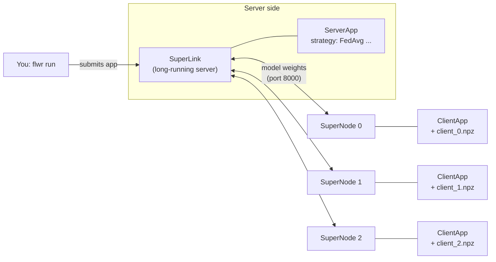

# 2. Running a Flower server and clients

This tutorial shows two ways to run the same federated app:

| | **A. Simulation** | **B. Deployment** |
|---|---|---|
| How | one `flwr run` command | one terminal for the server, one per client, one to submit the run |
| Clients are | simulated by Flower (Ray) in one process tree | real, independent processes (could be on different machines) |
| Use it for | experiments, many clients, quick iterations | understanding the architecture, demos, running on several machines |
| Speed (3 clients, 5 rounds, CPU) | ~30 s | ~2–3 min (each round starts fresh client processes) |

**The code is identical in both modes.** Only the way you start it changes.

> Before you start: create the environment ([tutorial 1](01_environment_setup.md)) and the data partitions:
>
> ```bash
> source .venv/bin/activate
> python data_splitting/split_data.py --dataset dermamnist --num-clients 3 --strategy dirichlet --alpha 0.3
> ```
>
> This writes `data/partitions/dirichlet/{client_0,client_1,client_2,test}.npz` (more in [tutorial 3](03_biased_data_splits.md)).

---

## 0. Flower vocabulary



| Term | What it is | In this repo |
|---|---|---|
| **ServerApp** | *Your* server code: builds the global model, picks the strategy, runs the rounds | `fl_app/aitdm_fl/server_app.py` |
| **ClientApp** | *Your* client code: receives the global model, trains or evaluates on local data, sends it back | `fl_app/aitdm_fl/client_app.py` |
| **SuperLink** | Flower's long-running server process. Clients connect to it, and it runs the ServerApp | `flower-superlink` |
| **SuperNode** | Flower's long-running client process (one per hospital/device). It runs the ClientApp | `flower-supernode` |
| **run config** | Hyperparameters shared by everybody (rounds, lr, strategy, ...) | `[tool.flwr.app.config]` in `fl_app/pyproject.toml` |
| **node config** | Settings of *one* SuperNode (which data it owns) | `--node-config "data-path='...'"` |


### A round, step by step

1. The ServerApp sends the current global weights to every connected ClientApp (`@app.train()`).
2. Each ClientApp trains `local-epochs` epochs on its own partition and replies with its new weights
   and `num-examples`.
3. The strategy aggregates them (FedAvg: weighted average by `num-examples`).
4. The ClientApps evaluate the new global model on their local validation data (`@app.evaluate()`).
   This is how you follow the training: `aggregate_evaluate` in the log.
5. After the **last** round, the ServerApp evaluates the final model once on the held-out
   **global test set** (`global_evaluate`). The test set is only for the final number: if you
   looked at it every round and adjusted your settings, it would no longer be a fair test.

The clients never see the test set. A client only has its own `client_<i>.npz`; the server
tells it the number of classes.

---

## A. Simulation: one command

### With the script

```bash
bash scripts/run_simulation.sh                                   # data/partitions/dirichlet
bash scripts/run_simulation.sh data/partitions/iid               # another split
bash scripts/run_simulation.sh data/partitions/dirichlet "num-server-rounds=10 strategy='fedprox'"
```

The script reads the number of clients from `meta.json`. At the end it prints where the
model and metrics were saved (`outputs/sim-<split>-<timestamp>/`).

### With the raw Flower command

This is what the script runs:

```bash
source .venv/bin/activate
export FLWR_DISABLE_RUNTIME_DEPENDENCY_INSTALLATION=1   # see the first bullet below
cd fl_app
flwr run . --stream \
    --federation-config "num-supernodes=3" \
    --run-config "partitions-dir='$PWD/../data/partitions/dirichlet' num-server-rounds=5"
```

* `FLWR_DISABLE_RUNTIME_DEPENDENCY_INSTALLATION=1` stops Flower from installing the app's
  dependencies into a separate environment at every run (a multi-GB download). The venv already
  has everything ([details in Troubleshooting](#troubleshooting)).
* `.` is the app folder (the one containing `pyproject.toml`).
* `--stream` shows the logs live. Without it, `flwr run` only prints a run ID
  (`flwr log <run-id>` shows the logs later, and `flwr ls` lists the runs).
* `--federation-config "num-supernodes=3"` sets how many clients are simulated.
  **Since Flower 1.32 the default is 2.** Our server waits for `min-nodes=3` clients, so
  without this flag it waits forever.
* `--run-config` overrides any key of `[tool.flwr.app.config]` in `fl_app/pyproject.toml`.
  `partitions-dir` **must be an absolute path**, because Flower runs your app from its own folder.
* In simulation, Flower sets `partition-id` = 0, 1, 2, ... automatically, so client *i* reads `client_<i>.npz`.

> **What happens in the background:** the first `flwr run .` starts a hidden *local
> SuperLink* (`127.0.0.1:39091`) and leaves it running for the next runs. If you switch
> venvs or something looks stuck, run `bash scripts/stop_flower.sh`.

### Sample output

```text
INFO :      [ROUND 1/5]
INFO :      aggregate_train: Received 5 results and 0 failures
INFO :      	└──> Aggregated MetricRecord: {'train_loss': 0.9296485804148229, ...}
INFO :      aggregate_evaluate: Received 5 results and 0 failures
INFO :      	└──> Aggregated MetricRecord: {'eval_loss': 0.9466..., 'eval_acc': 0.6780..., 'eval_bal_acc': 0.1918..., ...}
...
INFO :      [ROUND 5/5]
INFO :      	└──> Aggregated MetricRecord: {'eval_loss': 0.7719..., 'eval_acc': 0.715, 'eval_bal_acc': 0.3516..., ...}
[round 5] global test: loss=0.7534, accuracy=0.7302, balanced_accuracy=0.3625, f1_macro=0.3779
Saved final model and metrics to .../outputs/sim-iid-20261021-232538
```

`eval_*` are the clients' validation metrics (averaged, weighted by client size), printed every
round. The `global test` line appears once, at the end. For learning curves of the test set in
your report, add `test-every-round=true`, but never choose settings by looking at them.

---

## B. Deployment: every component in its own terminal

This is how a real federation works: the server and each client are separate, long-running
processes. Each client only knows the path to **its own** data.

Open **5 terminals** in the repository root and activate the venv in each one
(`source .venv/bin/activate`; the scripts also do it for you).

### Terminal 1: the server (SuperLink)

```bash
bash scripts/start_superlink.sh
```

<details><summary>Raw command</summary>

```bash
flower-superlink --insecure --disable-runtime-dependency-installation
```
</details>

It listens on `127.0.0.1:8000`. Leave it running.

### Terminals 2, 3, 4: one client (SuperNode) each

```bash
bash scripts/start_supernode.sh 0      # terminal 2 -> data/partitions/dirichlet/client_0.npz
bash scripts/start_supernode.sh 1      # terminal 3 -> client_1.npz
bash scripts/start_supernode.sh 2      # terminal 4 -> client_2.npz
```

To use another split, pass its folder: `bash scripts/start_supernode.sh 0 data/partitions/iid`.

<details><summary>Raw command</summary>

```bash
flower-supernode --insecure \
    --superlink 127.0.0.1:8000 \
    --port 9094 \
    --node-config "data-path='/ABSOLUTE/path/to/data/partitions/dirichlet/client_0.npz'"
```

* `--superlink`: where the server is.
* `--port`: a local port for the SuperNode ↔ ClientApp communication. **Every SuperNode on the same
  machine needs a different one** (9094, 9095, 9096, ...).
* `--node-config "data-path=..."`: this client's data. The ClientApp reads it in `get_data_path()`.
  As an alternative, `--node-config "partition-id=0 num-partitions=3"` makes the ClientApp load
  `<partitions-dir>/client_0.npz`.
</details>

### Terminal 5: submit the app

```bash
bash scripts/submit_run.sh
# or with overrides:
bash scripts/submit_run.sh data/partitions/dirichlet "num-server-rounds=10 strategy='fedmedian'"
```

<details><summary>Raw commands</summary>

`flwr run` needs a named *connection* to your SuperLink. Connections are stored in the Flower
config file; `flwr config list` shows where it is (usually `~/.flwr/config.toml`). Add this once
(`submit_run.sh` does it for you):

```toml
[superlink.local-deployment]
address = "127.0.0.1:8000"
insecure = true
```

Then:

```bash
cd fl_app
flwr run . local-deployment --stream \
    --run-config "partitions-dir='/ABSOLUTE/path/to/data/partitions/dirichlet' min-nodes=3"
```
</details>

The training logs appear in terminal 5. Terminals 2–4 show each client receiving and sending messages.
You can submit more runs to the same SuperLink and SuperNodes. Stop everything with **Ctrl+C**
in each terminal, or with `bash scripts/stop_flower.sh`.

### B'. Deployment from a single terminal

`run_deployment_local.sh` does exactly the [steps above](#b-deployment-every-component-in-its-own-terminal). It starts the SuperLink and one SuperNode
per client in the background, writes their logs to `logs/`, submits the run, and shuts everything
down at the end:

```bash
bash scripts/run_deployment_local.sh                       # data/partitions/dirichlet
bash scripts/run_deployment_local.sh data/partitions/iid "num-server-rounds=3"
tail -f logs/supernode_0.log                               # in another terminal, to watch a client
```

### B''. One window per component, automatically opened (with re-runs)

`run_deployment_terminals.sh` opens the windows of the [steps above](#b-deployment-every-component-in-its-own-terminal) for you: one **SuperLink** window, one **SuperNode** window per client and one **Submit run**
window.

The first run starts by itself. Nothing is shut down afterwards: when a component stops, its window shows a menu, so you can re-run components individually.

```bash
bash scripts/run_deployment_terminals.sh                       # data/partitions/dirichlet
bash scripts/run_deployment_terminals.sh data/partitions/iid "num-server-rounds=3"
```

| Window | When its component stops | Menu |
|---|---|---|
| Submit run | after every run | **[Enter]** submit the same run again · **[e]** edit the run-config overrides first (e.g. `num-server-rounds=10 strategy='krum'`) · **[q]** close |
| SuperNode *i* | after **Ctrl+C** in that window | **[Enter]** restart · **[m]** restart as an attacker (`malicious=true`, see [tutorial 4](04_aggregation_strategies.md)) · **[h]** restart as an honest client · **[q]** close |
| SuperLink | after **Ctrl+C** in that window | **[Enter]** restart · **[q]** close |

* **Ctrl+C stops only the component of that window.** The other windows keep running.
* **Restarting the SuperLink** makes it forget all clients.
  The SuperNode windows notice it and reconnect by themselves after 3 s, keeping their settings (an attacker stays an attacker).
* **Example session**: run FedAvg → Ctrl+C in *SuperNode 2* and press **m** → **e** in *Submit run* and change the overrides to `strategy='krum'` → compare the two results in `outputs/`.
* Stop everything: **q** in every window, or `bash scripts/stop_flower.sh`.

The script finds a terminal program by itself: GNOME Terminal, Konsole, Xfce Terminal or xterm on Linux, Terminal on macOS, and **tmux** when there is no graphical desktop (SSH, or WSL without GUI).

To choose one, set `FL_TERMINAL`, e.g. `FL_TERMINAL=tmux bash scripts/run_deployment_terminals.sh`.

On WSL2, if no window opens, install one: `sudo apt install xterm` (or `tmux`).
In tmux, switch windows with `Ctrl+b n` / `Ctrl+b p` (`Ctrl+b w` lists them).

### Running on several machines

1. Server machine: `HOST=0.0.0.0 bash scripts/start_superlink.sh` (open port 8000 in the firewall).
2. Each client machine (with the repo, the venv and **only its own** `client_<i>.npz`, e.g. in
   `data/partitions/dirichlet/`): `bash scripts/start_supernode.sh <i> data/partitions/dirichlet <SERVER_IP>:8000`.
   The client does not need `test.npz` or the other clients' files; only the server machine has them.
3. Any machine: change `address` in the `local-deployment` connection to `<SERVER_IP>:8000` and run `submit_run.sh`.

> `--insecure` means no TLS, which is fine for our introductory laboratory. 

> Real deployments must enable [TLS](https://flower.ai/docs/framework/how-to-enable-tls-connections.html) and [SuperNode authentication](https://flower.ai/docs/framework/how-to-authenticate-supernodes.html).

---

## Configuration reference

Change the defaults in `fl_app/pyproject.toml`, or override them per run with
`--run-config "key=value key2='text'"` (strings need quotes):

| Key | Default | Meaning |
|---|---|---|
| `partitions-dir` | `""` | **Absolute** folder created by `split_data.py` (the scripts fill it in) |
| `save-dir` | `""` | Where the server saves `final_model.pt` + `metrics.json` (`""` = don't save) |
| `num-server-rounds` | `5` | Federated rounds |
| `local-epochs` | `1` | Epochs each client trains per round |
| `learning-rate` | `0.001` | Adam learning rate (sent by the server to the clients) |
| `batch-size` | `32` | |
| `loss-weighting` | `"none"` | `"balanced"`: each client weights its loss by inverse class frequency, so rare classes count more ([tutorial 5](05_gradcam.md#iteration-1-make-the-rare-classes-count-action-a)) |
| `strategy` | `"fedavg"` | `fedavg`, `fedprox`, `fedavgm`, `fedadam`, `fedyogi`, `fedmedian`, `fedtrimmedavg`, `krum`, `qfedavg` ([tutorial 4](04_aggregation_strategies.md)) |
| `proximal-mu`, `server-momentum`, `server-lr`, `trim-beta`, `num-malicious`, `qfedavg-q`, `qfedavg-client-lr` | see `pyproject.toml` | strategy hyperparameters |
| `dp-noise-multiplier`, `dp-clipping-norm`, `dp-delta` | `0.0`, `1.0`, `1e-5` | central differential privacy (0 = off), ε is reported |
| `malicious-clients`, `attack` | `""`, `"sign-flip"` | turn clients into attackers (robustness experiments) |
| `attack-inflate-examples` | `1` | attackers multiply the `num-examples` they report ([tutorial 4](04_aggregation_strategies.md#attackers-can-also-lie-about-their-size)) |
| `fraction-train` / `fraction-evaluate` | `1.0` | Fraction of clients sampled each round |
| `min-nodes` | `3` | The server waits for this many clients (the scripts set it to the number of clients) |
| `seed` | `1` | Seeds the initial model, the clients' shuffling / augmentation and the DP noise: the same seed gives the same result |
| `test-every-round` | `false` | `true` = evaluate the test set every round (for curves only), else only after the last round |

### Outputs

`outputs/<run>/metrics.json` contains:

* `evaluate_metrics_clientapp`: per round, the weighted average of the clients' local validation metrics,
* `train_metrics_clientapp`: per round, the average training loss,
* `evaluate_metrics_serverapp`: the global test set metrics (accuracy, **balanced accuracy,
  macro-F1**) after the last round.

Load the weights for analysis (Grad-CAM, robustness tests, ...) like this:

```python
import torch
from aitdm_fl.task import model_from_test_set
model = model_from_test_set("data/partitions/dirichlet")
model.load_state_dict(torch.load("outputs/<run>/final_model.pt"))
```

---

## Centralised baseline and seeds

Two things every report needs:

**1. A centralised baseline** (Stage 1): the same model, trained on the union of all clients'
training data, as if the data could be pooled in one place.

```bash
python experiments/centralised.py --partitions data/partitions/dirichlet --epochs 10
```

**2. Several seeds.** One run is one sample: differences of a few points between two runs can be
pure chance. Every run is seeded (`seed` in the run config), so a result can be reproduced exactly,
and `run_seeds.py` runs seeds 1, 2, 3 for you:

```bash
python experiments/run_seeds.py --partitions data/partitions/dirichlet --config "num-server-rounds=10" --name fedavg
python experiments/run_seeds.py --partitions data/partitions/dirichlet --config "num-server-rounds=10 loss-weighting='balanced'" --name fedavg-balanced
python experiments/summarize.py outputs/experiments/central-dirichlet outputs/experiments/fedavg outputs/experiments/fedavg-balanced
```

```text
| Experiment | Val acc. | Val bal. acc. | Val macro-F1 | Worst client val acc. |
|---|---|---|---|---|
| central-dirichlet | 0.724 ± 0.015 | 0.458 ± 0.008 | 0.426 ± 0.056 | 0.585 ± 0.016 |
| fedavg | 0.719 ± 0.003 | 0.293 ± 0.033 | 0.300 ± 0.026 | 0.467 ± 0.032 |
| fedavg-balanced | 0.643 ± 0.047 | 0.422 ± 0.030 | 0.364 ± 0.052 | 0.439 ± 0.020 |
```

(DermaMNIST, the quick-start split. The federated model matches the centralised accuracy, but not its balanced accuracy, and its worst client is far behind: [tutorial 5](05_gradcam.md#the-iterative-process-from-explanation-to-a-better-model) works through this example.)

Both scripts evaluate every model in the same way (`experiments/evaluation.py`):

* **validation**: all clients' validation sets together, plus one number per client. Compare and
  choose your settings on these.
* **test**: the global test set. Add `--with-test` to `summarize.py` only for the final table of
  your report, once you have decided.

Small differences of results between machines (or between simulation and deployment) remain
possible: floating-point sums depend on the order in which client updates arrive.

`bash experiments/reproduce_tutorials.sh` re-creates every number in these tutorials this way.

---

## Where to change aspects for my project

The absolute path towards all those files is `fl_app/aitdm_fl/`.

| I want to... | Edit |
|---|---|
| use another model | `build_model()` in `task.py` (any MONAI / torchvision network; `build_mlp()` for feature data) |
| use my own dataset | images: `split_data.py --input data.npz`; CSV (e.g. HAR): `split_data.py --input *.csv`, see [tutorial 6](06_har.md). Other formats: `load_npz_arrays()` / `load_client_data()` / `load_test_data()` in `task.py` |
| use or write another aggregation strategy | `build_strategy()` in `server_app.py`, see [tutorial 4](04_aggregation_strategies.md) |
| find where the model fails (per class, per client, hardest examples) | `python explainability/error_analysis.py --run outputs/<run>`, see [tutorial 5](05_gradcam.md#the-iterative-process-from-explanation-to-a-better-model) |
| explain the trained model | images: `python explainability/gradcam.py --run outputs/<run>` ([tutorial 5](05_gradcam.md)); features: `explainability/feature_importance.py` ([tutorial 6](06_har.md)) |
| send extra values to clients every round | `train_config=ConfigRecord({...})` in `server_app.py`, read `msg.content["config"]` in `client_app.py` |
| report extra metrics | add them to the `MetricRecord` in `client_app.py` / `evaluate()` in `task.py` |

---

## Troubleshooting

| Symptom | Cause / fix |
|---|---|
| Run hangs with `Waiting for nodes to connect: 2 connected (minimum required: 3)` | Fewer clients than `min-nodes`. In simulation pass `--federation-config "num-supernodes=N"`. In deployment start all N SuperNodes |
| `Address already in use` (8000, 9094, ...) | An old SuperLink or SuperNode is still running: `bash scripts/stop_flower.sh` |
| `FileNotFoundError: .../test.npz` | Run `split_data.py` first and pass an **absolute** `partitions-dir` |
| First run downloads GBs / "Installing application dependencies..." | Recent Flower versions install the app dependencies into a separate env per run. Our scripts disable this with `FLWR_DISABLE_RUNTIME_DEPENDENCY_INSTALLATION=1` / `--disable-runtime-dependency-installation` because the venv already has everything. If you started `flwr run .` yourself before, run `bash scripts/stop_flower.sh` once |
| `Recommended property "license" missing` | Harmless metadata warning |
| `Since flwr 1.32, default simulated SuperNodes changed from 10 to 2` | Harmless; we always pass `num-supernodes` explicitly |
| Clients can't reach the server on a cluster | Server and clients must run on the **same node**, or use the server's real IP, not `127.0.0.1` |
