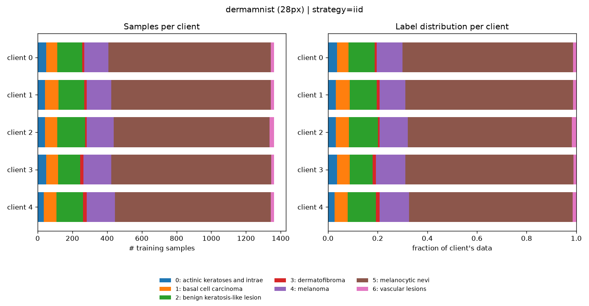
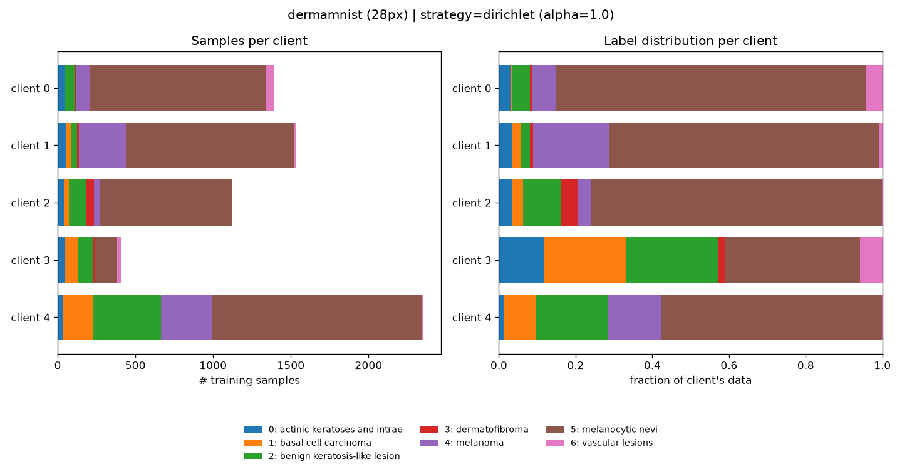
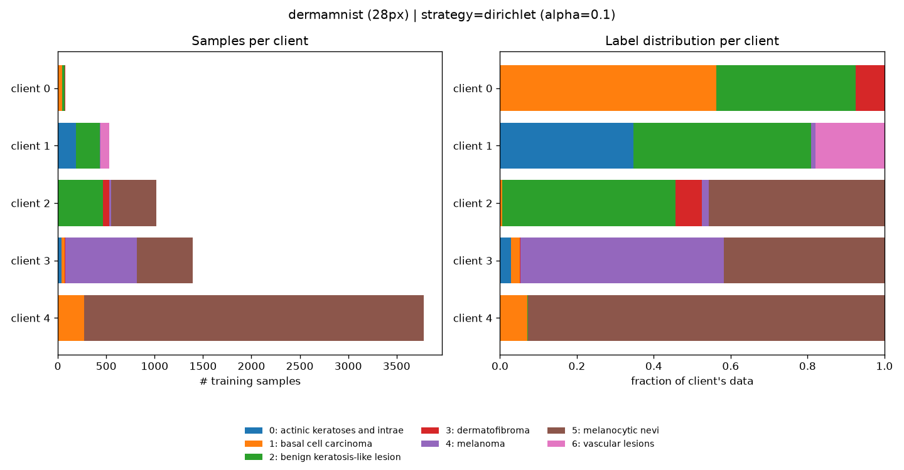
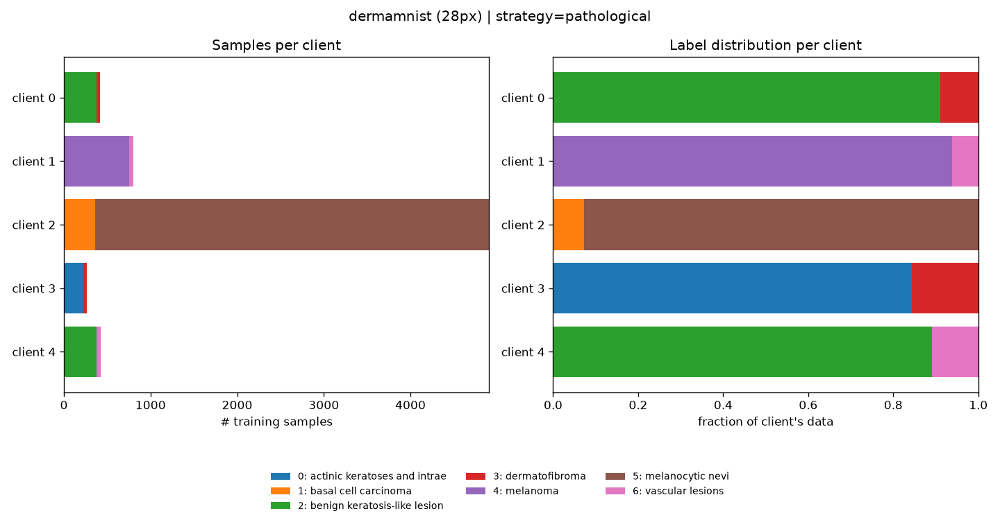
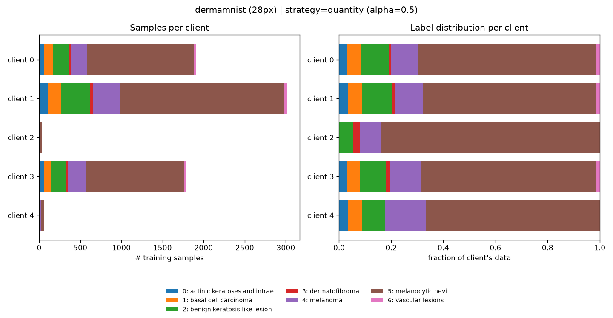
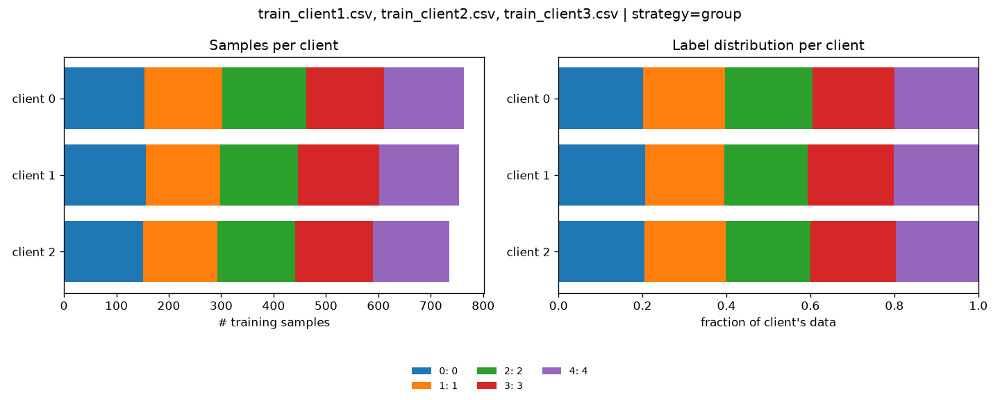
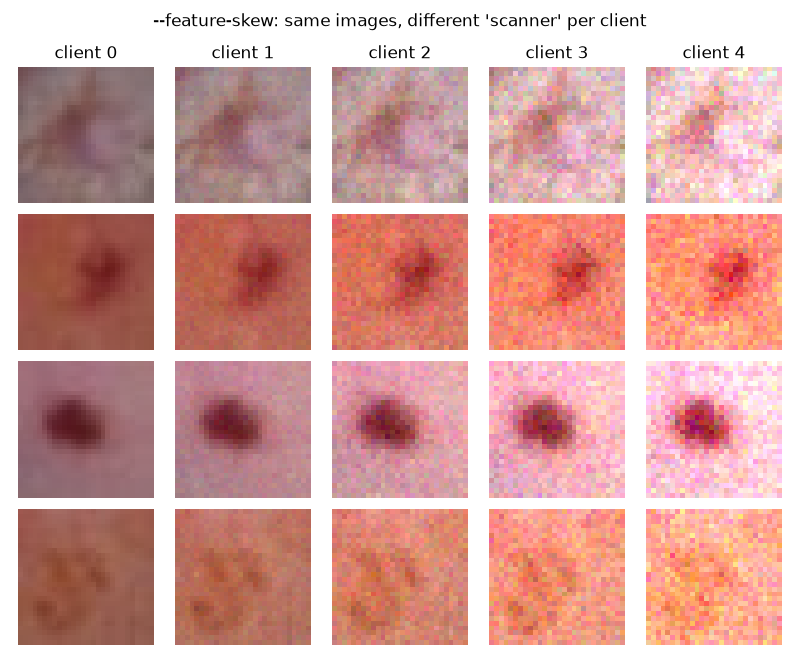

# 3. Splitting data in a biased (non-IID) way

In a tutorial, federated data is usually split **IID**: every client gets a random,
equally sized slice with the same class distribution. Real federations never look like this:

| Real world | Kind of bias | `split_data.py` option |
|---|---|---|
| A children's hospital sees different diseases than an oncology centre | **label skew** | `--strategy dirichlet --alpha 0.3` |
| A specialised clinic only sees 1–2 conditions | **extreme label skew** | `--strategy pathological --classes-per-client 2` |
| A university hospital has 50× more scans than a rural clinic | **quantity skew** | `--strategy quantity --alpha 0.5` |
| Each phone / camera / patient is one client | **natural (group) split** | `--strategy group --group-col Camera` |
| Hospitals use different scanners (brightness, noise) | **feature skew** | `--feature-skew` |
| One site has a tired / inexperienced annotator | **label noise** | `--label-noise 0,0,0.2` |

The project guidelines ask for *"3–5 federated clients with non-IID data splits"*. This
tutorial shows how to create them and how to *show* that they are non-IID.

---

## The tool

```bash
source .venv/bin/activate
python data_splitting/split_data.py --help
```

You need **one data source**:

* `--dataset <name>`: downloads a [MedMNIST](https://medmnist.com/) 2D dataset into `data/raw/`
  (`dermamnist` (skin lesions, ISIC), `pneumoniamnist`, `bloodmnist`, `pathmnist`, `breastmnist`, ...).
  Add `--size 64` (or 128 / 224) for the larger MedMNIST+ images: slower, but more realistic and with sharper Grad-CAMs ([tutorial 5](05_gradcam.md)). `meta.json` stores the real class names.
* `--input <file>`: your own data:
  * `.npz` with images and labels (`--x-key images --y-key labels` by default; MedMNIST-style
    `train_images/train_labels/...` files are detected automatically),
  * one or more `.csv` files with one row per sample, or several rows per sample (e.g. video
    frames, using `--sample-col`). Besides the CSV partitions, each sample is turned into a
    feature vector in `client_<i>.npz`, so the Flower app can train on it.
    See [tutorial 6](06_har.md) for the HAR skeleton data.

It writes to `data/partitions/<strategy>/` (or `--out <folder>`):

```text
data/partitions/dirichlet/
├── client_0.npz            x_train, y_train, x_val, y_val of client 0   (.csv input: also client_0_train.csv / client_0_val.csv)
├── client_1.npz
├── client_2.npz
├── test.npz                global held-out test set, NEVER split, NEVER biased (used by the server)
├── meta.json               all settings + class counts per client (paste into your report!)
└── label_distribution.png  plot of the split
```

It also prints a table. **majority%** is the share of the most frequent class on each client:

```text
Training samples per class and client
client         0       1       2       3       4       5       6    total  majority%
-----------------------------------------------------------------------------------
0             13      14       6       0      40     344      66      483      71.2
1            184      71     750       6       4    3390       2     4407      76.9
2             20     266       5      73     708     813      33     1918      42.4
```

The Flower app in `fl_app/` reads these files directly
(see [tutorial 2](02_running_flower.md)): `bash scripts/run_simulation.sh data/partitions/<strategy>`.

---

## The strategies

All examples use DermaMNIST (7 skin-lesion classes; class 5 "melanocytic nevi" is 67 % of the data) with 5 clients.
The **left** panel shows how many samples each client has; the **right** panel shows each client's class mix.

### 1. IID (the baseline)

```bash
python data_splitting/split_data.py --dataset dermamnist --num-clients 5 --strategy iid
```

Shuffle, then cut into equal parts. Every client looks like the full dataset. Use it as the
*upper bound* that you compare the biased splits against.



### 2. Label skew with a Dirichlet distribution (the standard in FL papers)

```bash
python data_splitting/split_data.py --dataset dermamnist --num-clients 5 --strategy dirichlet --alpha 1.0
python data_splitting/split_data.py --dataset dermamnist --num-clients 5 --strategy dirichlet --alpha 0.1 --out data/partitions/dirichlet_0.1
```

For every class *c*, draw how its samples are shared between the clients:
p<sub>c</sub> ~ Dir($\alpha_1$, $\alpha_2$, ..., $\alpha_K$), then give client *k* a fraction p<sub>c,k</sub> of class *c*.
**α controls the bias**:

| α | Effect |
|---|---|
| 100 | practically IID |
| 1.0 | moderate: every client has most classes, in different proportions |
| 0.1 | extreme: most clients are dominated by 1–2 classes, and sizes differ too |

| α = 1.0 | α = 0.1 |
|---|---|
|  |  |

`--min-samples` (default 20) re-draws the split until every client has at least that many samples.

### 3. Pathological split

```bash
python data_splitting/split_data.py --dataset dermamnist --num-clients 5 --strategy pathological --classes-per-client 2
```

Each client owns **exactly K classes**, as in the original FedAvg paper (McMahan et al., 2017).
This is the worst case for FedAvg: the local models pull the global model in completely
different directions (*client drift*).



### 4. Quantity skew

```bash
python data_splitting/split_data.py --dataset dermamnist --num-clients 5 --strategy quantity --alpha 0.5
```

Same class mix everywhere, but very different sizes (client sizes ~ Dir($\alpha$)).

It tests whether weighting by `num-examples` (FedAvg) lets big clients dominate, which is a **fairness** question for the small ones.



### 5. Natural / group split (the most realistic)

If your data says *who* produced each sample as metadata (subject, device, camera, hospital), use that as the client. All samples of a group then stay on the same client, just as in reality.

Example with the HAR skeleton CSVs (columns `IDSample, FrameNumber, J1X ... J25Z, Action, Camera`, several rows/frames per sample), one client per camera:

```bash
python data_splitting/split_data.py --input data/raw/har/train_client*.csv \
    --label-col Action --sample-col IDSample --feature-cols '^J' \
    --strategy group --group-col Camera --num-clients 3
```

* `--label-col`: the column holding the class.
* `--sample-col`: rows with the same value form **one** sample and are never separated.
* `--feature-cols`: regular expression selecting the feature columns (default: all numeric ones).
* `--group-col`: one client per value. If there are more groups than clients, groups are packed
  so that client sizes stay balanced. With several input files, `--group-col source_file` gives
  one client per file.

The full HAR walkthrough is in [tutorial 6](06_har.md).



For HAR, try `--group-col` with the subject / user id, which simulates one phone per person.
For NPZ data, store the group array in the file and pass its key: `--group-col subject`.

---

## Extra real-world bias (combine with any strategy)

### Feature skew: "every hospital has a different scanner"

```bash
python data_splitting/split_data.py --dataset dermamnist --num-clients 5 --strategy iid --feature-skew --out data/partitions/iid_feature_skew
```

Client 0 gets darker, clean images; the last client gets brighter, noisier images. Labels are unchanged, so this is pure **covariate shift**. The global `test.npz` is never modified.



Edit `apply_feature_skew()` in `data_splitting/partitioning.py` to simulate other artefacts (blur, contrast, colour casts, JPEG compression, ...).

For CSV data (sensors, skeletons) `--feature-skew` simulates differently calibrated devices instead: every client gets its own gain and offset per column, plus measurement noise that grows
from client 0 (clean) to the last client (`apply_sensor_skew()`).

### Label noise: "one unreliable annotator"

```bash
python data_splitting/split_data.py --dataset dermamnist --num-clients 3 --strategy dirichlet --alpha 0.5 \
    --label-noise 0,0,0.3 --out data/partitions/noisy
```

Flips 30 % of client 2's **training** labels to a random wrong class. Validation and test labels stay clean, so you can measure the damage. 

This is a simple **data-poisoning / robustness** scenario for Stage 2: Compare `strategy='fedavg'` with `strategy='fedmedian'` in those circumstances.

### A "realistic" preset

```bash
python data_splitting/split_data.py --dataset dermamnist --num-clients 3 --strategy dirichlet --alpha 0.3 \
    --feature-skew --label-noise 0,0,0.2 --out data/partitions/realistic
bash scripts/run_simulation.sh data/partitions/realistic
```

---

## Does the bias matter?

Same model and settings (5 rounds, 1 local epoch, 5 clients), different splits, evaluated on the same global test set:

```bash
for s in iid pathological; do
  python data_splitting/split_data.py --dataset dermamnist --num-clients 5 --strategy $s
  bash scripts/run_simulation.sh data/partitions/$s
done
```

Results we obtained (one seed, CPU) - if rerun numbers will differ slightly:

| Split | Strategy | Accuracy | Balanced acc. | Macro-F1 |
|---|---|---|---|---|
| IID | FedAvg | 0.716 | 0.293 | 0.323 |
| Dirichlet $\alpha$ = 1.0 | FedAvg | 0.718 | 0.303 | 0.325 |
| Quantity $\alpha$ = 0.5 | FedAvg | 0.729 | 0.347 | 0.367 |
| Dirichlet $\alpha$ = 0.1 | FedAvg | 0.690 | 0.246 | 0.186 |
| Dirichlet $\alpha$ = 0.1 | FedProx ($\mu$ = 0.1) | 0.689 | 0.223 | 0.181 |
| Pathological (2 classes/client) | FedAvg | 0.672 | 0.255 | 0.175 |
| Pathological (2 classes/client) | FedProx ($\mu$ = 0.1) | 0.695 | 0.236 | 0.185 |

Things to notice (and to discuss in your report):

* **Accuracy oversaturates and hides the problem.** Accuracy stays around 0.67–0.73 because predicting the majority class already yields this response.
* **Macro-F1 drops by about 40 %** under strong label skew. Always report balanced accuracy / macro-F1 / per-class metrics on imbalanced medical data.
* Mild bias (α = 1) costs almost nothing. Strong bias (α = 0.1, pathological) does.
* FedProx is not a free win. Tune `proximal-mu`, train for more rounds, and compare.
* Five rounds are far too few for conclusions. Use more rounds, several seeds (`--seed`), and report mean ± std.

---

## Using the partitions outside Flower

Each client file is a plain NumPy archive:

```python
import numpy as np
d = np.load("data/partitions/dirichlet/client_0.npz")
x_train, y_train, x_val, y_val = d["x_train"], d["y_train"], d["x_val"], d["y_val"]
t = np.load("data/partitions/dirichlet/test.npz")
x_test, y_test = t["x_test"], t["y_test"]
```

That makes it easy to:

* train a **centralised baseline** (concatenate all clients' `x_train`) on the same `test.npz`,
* train a **local-only** model per client and compare it with the federated one,
* do **cross-evaluation** in teams: each member owns one `client_<i>.npz`, and everybody evaluates
  everybody's model.

The splitting algorithms are plain functions in `data_splitting/partitioning.py`
(`iid_split`, `dirichlet_split`, `pathological_split`, `quantity_split`, `group_split`), so you can
import them in a notebook. Flower also ships its own partitioners for Hugging Face datasets
(`DirichletPartitioner`, `PathologicalPartitioner`, ...) in
[Flower Datasets](https://flower.ai/docs/datasets/ref-api/flwr_datasets.partitioner.html).

## Good practice

* Fix `--seed` and keep `meta.json` with your results, so every split is reproducible.
* Never put test data into client partitions, as it would leak into the server and general reporting. `test.npz` is the only unbiased benchmark.
* Show the `label_distribution.png` of your split in the report (Stage 1 asks you to describe the partitioning).
* Check the per-client tables: a client with 10 samples or a single class may make the training completely unstable. The solutions to when this happens is to remove the client from the federation, or to downweight its importance in the aggregation (e.g. `--strategy qfedavg`).