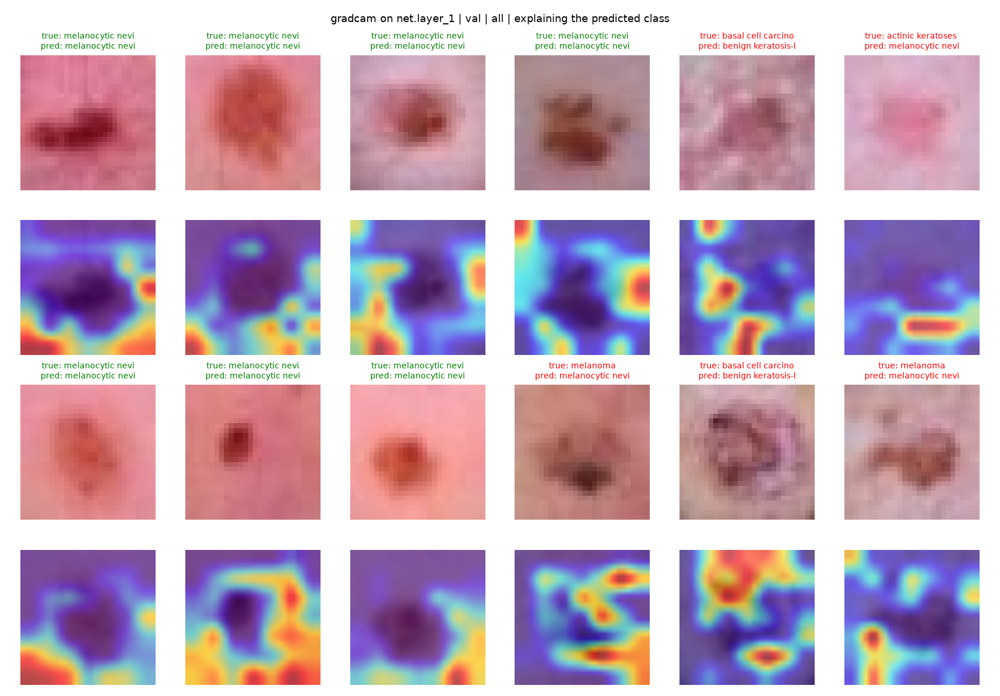
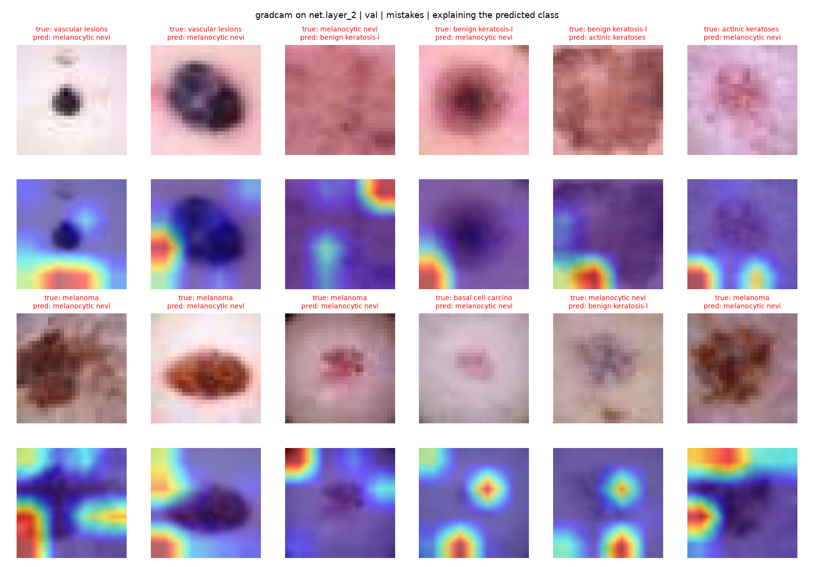
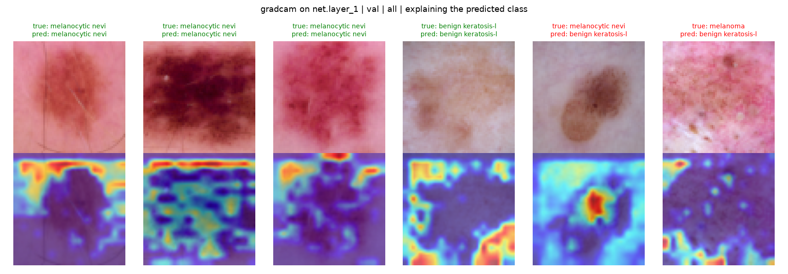
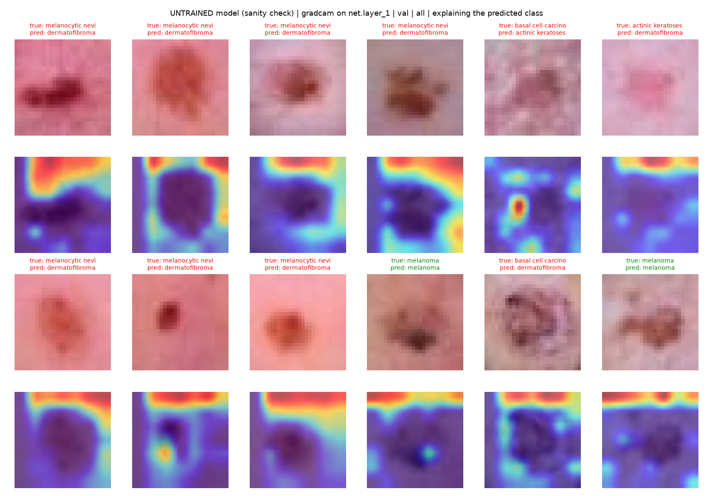
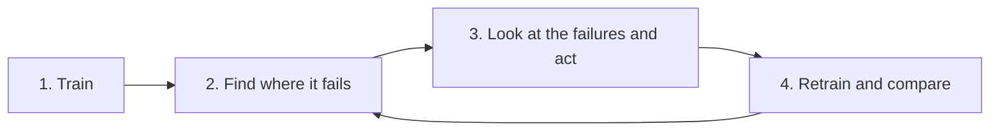
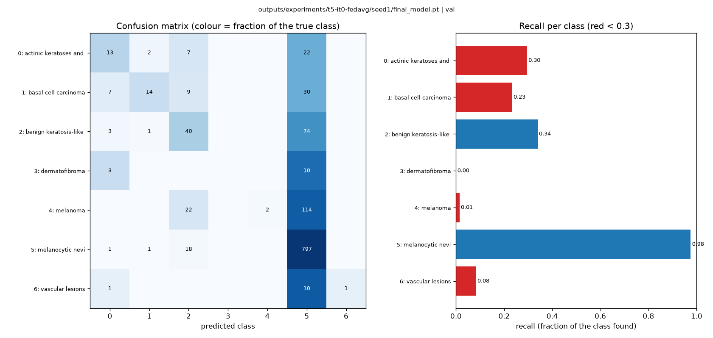
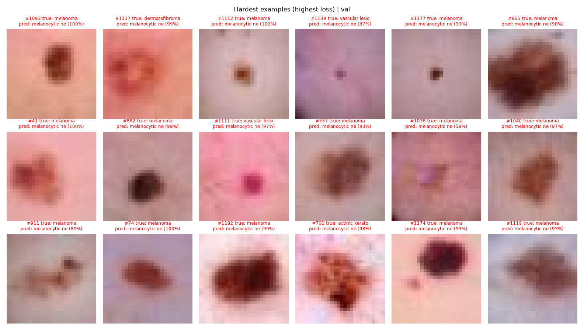
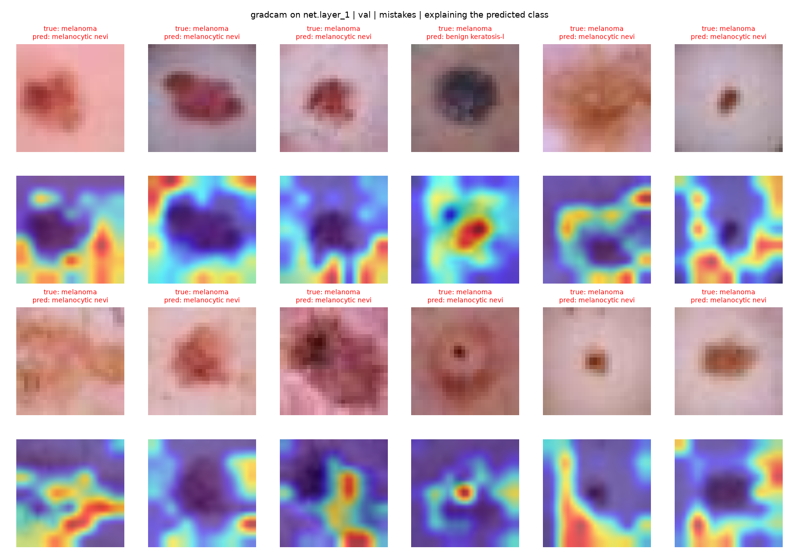
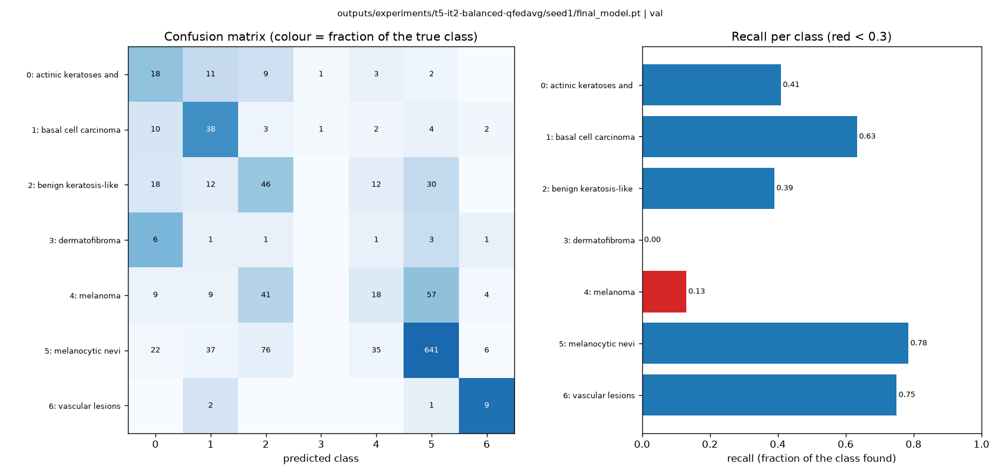
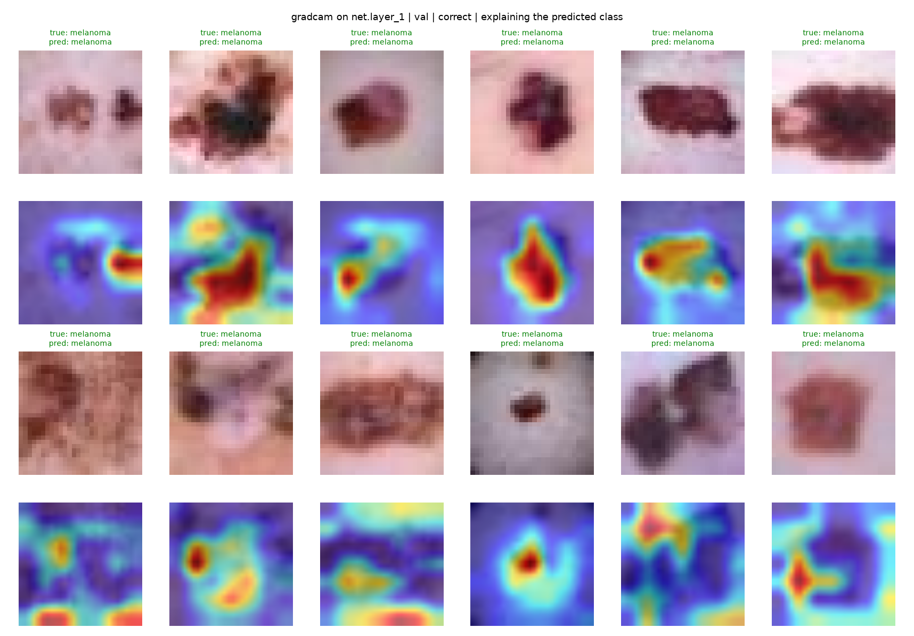

# 5. Explaining the model with Grad-CAM

A clinician will not trust *"melanoma, 87 %"* without knowing **where** the model looked.

Grad-CAM produces a heat map of the image regions that drove a prediction. It is the most common interpretability tool for CNNs.

Everything you need is already installed: `grad-cam` ([pytorch-grad-cam](https://github.com/jacobgil/pytorch-grad-cam)) is pinned in `requirements.txt`, together with its OpenCV dependency.

---

## How Grad-CAM works

For a class $c$ and a convolutional layer with feature maps, coming from $k$ = channel, $A^k$:

1. Back-propagate the class score $y^c$ to the layer: $\dfrac{\partial y^c}{\partial A^k}$.
2. Average the gradients over the $Z$ spatial positions $(i, j)$ to get one weight per channel:

   $$
   \alpha_k^c = \frac{1}{Z} \sum_{i} \sum_{j} \frac{\partial y^c}{\partial A^k_{ij}}
   $$

3. Take the weighted sum of the feature maps and keep the positive part:

   $$
   L^c = \mathrm{ReLU}\left( \sum_k \alpha_k^c \, A^k \right)
   $$

4. Upsample $L^c$ to the image size and overlay it (Hotness = importance).

Selvaraju et al., *Grad-CAM: Visual Explanations from Deep Networks via Gradient-based Localization*, ICCV 2017.

---

## Quick start

Train a model first; every run saves `outputs/<run>/final_model.pt`. Then:

```bash
source .venv/bin/activate
bash scripts/run_simulation.sh data/partitions/dirichlet "num-server-rounds=10"

python explainability/gradcam.py --run outputs/<run>          # 12 random validation images
```

The script reads the model and the partition folder it was trained on from the run folder. By
default it explains images from the **clients' validation sets** (all clients together): that is
the data to analyse and improve a model on. The global test set stays untouched until your final
numbers (`--data test` is possible, and reminds you of that).

It writes a PNG next to the model: the input on top, the heat map below, and the true and predicted class in the title (<span style="color:green">Green</span> = correct, <span style="color:red">Red</span> = wrong).



(All figures: the quick-start split, DermaMNIST 28 px, FedAvg, 10 rounds, seed 1.)

Look at where the high values are: **mostly around the lesion and at the image borders, rarely on
the lesion itself**, also for correct predictions. At 28 px with a 7×7 map this does not tell you
whether the model uses the lesion's outline, its contrast to the skin, or the skin itself, but it
is a clear question to investigate (bigger images below, and the
[iterative process](#the-iterative-process-from-explanation-to-a-better-model)).

### Options

| Option | Default | Meaning |
|---|---|---|
| `--run outputs/<run>` | | run folder (`final_model.pt` + `metrics.json`) |
| `--model x.pt --partitions dir` | | any other model, e.g. your centralised baseline |
| `--data` | `val` | `val` = all clients' validation sets, `client_<i>` = one client's validation data, `test` = global test set (final report only) |
| `--select` | `all` | `all`, `mistakes` or `correct` |
| `--num-images` | `12` | |
| `--method` | `gradcam` | `gradcam`, `gradcam++`, `hirescam`, `scorecam`, `eigencam` |
| `--layer` | `net.layer_1` | which layer to explain ([see below](#choosing-the-layer)) |
| `--target` | `predicted` | explain the `predicted` class, or the `true` class ("why *not* melanoma?") |
| `--untrained` | off | sanity check: same images, randomly initialised model |
| `--seed` | `0` | which images are picked |

```bash
python explainability/gradcam.py --run outputs/<run> --select mistakes            # only the errors
python explainability/gradcam.py --run outputs/<run> --data client_2 --method gradcam++
python explainability/gradcam.py --run outputs/<run> --select mistakes --target true
python explainability/gradcam.py --model baseline.pt --partitions data/partitions/iid
```

---

## Choosing the layer

Our MONAI `Classifier` downsamples a 28×28 image three times (`print(model)` shows the
structure):

| Layer | Feature map | Heat map |
|---|---|---|
| `net.layer_0` | 14×14 | detailed, but mostly edges and colours (low-level) |
| `net.layer_1` (default) | 7×7 | good compromise for 28×28 images |
| `net.layer_2` | 4×4 | the most "semantic" layer, but very blurry |

The original paper uses the **last** convolutional layer. With tiny MedMNIST images, that map is
only 4×4 pixels:



These are the model's **mistakes** on `net.layer_2`. The 4×4 maps can only point at a quarter of
the image, and most of them sit on a border or a corner, away from the lesion.

**Want sharper maps? Use bigger images.** MedMNIST+ comes in 64, 128 and 224 px, and the splitting tool downloads them with `--size`.

The model adapts to the image size automatically:

```bash
python data_splitting/split_data.py --dataset dermamnist --size 64 --num-clients 3 --strategy dirichlet --alpha 0.3 --out data/partitions/dirichlet64
bash scripts/run_simulation.sh data/partitions/dirichlet64 "num-server-rounds=10 loss-weighting='balanced'"
python explainability/gradcam.py --run outputs/<run> --num-images 6
```



At 64 px `net.layer_1` is 16×16, so the maps are much finer, and hair becomes visible in the images.
The high values are still mostly on the **skin and the image borders**, with one map on the
lesion: exactly the kind of possible shortcut you should investigate. (64 px is about 4× slower to train than 28
px; 224 px needs a GPU and a deeper network such as `monai.networks.nets.DenseNet121` in `build_model()`.)

---

## Sanity check: is the explanation about the *model* at all?

Adebayo et al. (*Sanity Checks for Saliency Maps*, NeurIPS 2018) showed that some saliency
methods give almost the same picture for a **random, untrained** network.

Such maps explain the image (edges, contrast), not the model. Always compare against a randomised model:

```bash
python explainability/gradcam.py --run outputs/<run> --untrained
```



Same 12 images as the first figure. The untrained network highlights the **top edge** of almost
every image, whatever is in it: an artefact of the architecture, not an explanation. The trained
maps look clearly different (around the lesion, varying between images), so they do reflect
something the model learned.

Only differences that appear **consistently** between the trained and untrained maps can be credited to what the model learned.
**Report this check!** In a paper, reviewers look for this comparison!

---

## What to look for and put in your report:

* **Right for the right reasons?** On correct predictions, is the   lesion highlighted, or the image border, a ruler, hair, a vignette or the skin colour? Background "shortcuts" are a classic failure in a lot of medical models.
* **Mistakes:** run `--select mistakes`. Do the errors share a pattern (low contrast, very small lesions, a specific class)? This feeds directly into data augmentation or cleaning, see [the iterative process](#the-iterative-process-from-explanation-to-a-better-model) below.
* **Fairness:** compare explanations across subgroups, e.g. skin tones or the image sources/clients. A model that looks at different evidence for different groups is a red flag.
* **Quantify, don't only show pictures:** with segmentation masks, measure how much of the heatmap falls inside the lesion (IoU), averaged over the validation data. **Cherry-picked examples are not evidence.**
* **Don't over-read the maps.** At 28 px the default layer gives a 7×7 map that is upsampled to the image: a heat map shows where the evidence *roughly* is, not which pixels mattered. Treat what you see as a hypothesis, check it against the [untrained sanity check](#sanity-check-is-the-explanation-about-the-model-at-all), and confirm it with numbers (e.g. bigger images, masking the region and measuring the change).

### Federated-learning specific ideas

| Question | How |
|---|---|
| Does federated training change *what* the model looks at? | Same images, `--run` of a federated model vs. your centralised baseline (`--model baseline.pt`) |
| Does a client with "a different scanner" get worse explanations? | Split with `--feature-skew`, then `--data client_0` vs. `--data client_4` |
| What does a poisoned or noisy client do to the explanations? | Runs with `malicious-clients='4'` or `--label-noise` (see [tutorial 4](04_aggregation_strategies.md)) vs. a clean run |
| Does DP noise destroy interpretability? | Runs with different `dp-noise-multiplier` values |
| How do explanations evolve during training? | Save the global model every round (extend `global_evaluate` in `server_app.py`) and compare round 1 vs. round N |

---

## The iterative process: from explanation to a better model

Explanations are only useful if they change what you do next. Improving a model is a loop:



| Step | Question | Tool |
|---|---|---|
| 1. Train | | `scripts/run_simulation.sh` |
| 2. Find where it fails | Which classes / clients are bad? Which examples always have a high loss? | `explainability/error_analysis.py` |
| 3. Look and act | **(a)** A class is never learned → get more data for it, or make its mistakes cost more (class-weighted loss).<br>**(b)** Some examples always have a high loss → look at them: wrong label, artefact, or genuinely hard? Find an augmentation that separates them from the class they are confused with.<br>**(c)** The task needs finer detail than the network sees → bigger images or a deeper network.<br>**(d)** Nothing above helps for some examples → remove them from training and report it. | `gradcam.py --select mistakes --true-class ...`, `loss-weighting='balanced'`, `--size 64`, `build_model()` |
| 4. Retrain and compare | Did the change help **the problem you targeted**, not only the average? | the same tools on the new run |

If a state-of-the-art model exists for your data, run it on your **validation** data too: the
examples *it* gets wrong are a good list of genuinely hard cases.

> **All of this happens on validation data, never on the test set.** Every look at the failures
> influences your next change. If those looks were on the test set, the final test number would
> be optimistic: you would have tuned the model to it (test-set overfitting). The scripts default
> to `--data val`, all clients' validation sets together (plus `--data client_<i>` for one
> client). The test set is evaluated **once**, for the final table.

Below is one complete pass on the quick-start split (DermaMNIST 28 px, 3 clients, Dirichlet
$\alpha = 0.3$, 10 rounds). Every number is a mean ± std over seeds 1, 2, 3, measured on the
**validation** data (`bash experiments/reproduce_tutorials.sh t5` re-creates them).

### Iteration 0: train and find where it fails

```bash
bash scripts/run_simulation.sh data/partitions/dirichlet "num-server-rounds=10"
python explainability/error_analysis.py --run outputs/<run>
```

```text
val: 1202 samples, accuracy 0.721, balanced accuracy 0.277

class                         support  recall  precision     f1  most confused with
actinic keratoses and intrae       44    0.30       0.46   0.36  melanocytic nevi (22)
basal cell carcinoma               60    0.23       0.78   0.36  melanocytic nevi (30)
benign keratosis-like lesion      118    0.34       0.42   0.37  melanocytic nevi (74)
dermatofibroma                     13    0.00       0.00   0.00  melanocytic nevi (10)  <-- never predicted correctly
melanoma                          138    0.01       1.00   0.03  melanocytic nevi (114)
melanocytic nevi                  817    0.98       0.75   0.85  benign keratosis-like lesion (18)
vascular lesions                   12    0.08       1.00   0.15  melanocytic nevi (10)

client   samples  accuracy  balanced acc.
0             85     0.776          0.339
1            778     0.833          0.366
2            339     0.451          0.255
```

(one run, seed 1)



An accuracy of 0.72 looks fine, but **the model has learnt "everything is a mole".**
Melanocytic nevi are 68 % of the validation data, and almost every other class is predicted as nevi.

**Melanoma, the class that matters most clinically, has a recall of 0.01** (0.01 ± 0.01 over the
3 seeds). This is failure (a). And one client, client 2, gets only 45 % of its own data right.

`error_analysis.py` also saves the hardest examples (highest loss):



They are almost all melanomas, dermatofibromas and vascular lesions predicted as nevi, most of them
with more than 90 % confidence. Nothing suggests broken images or obvious labelling errors (for
that, ask a domain expert), so (d) does not apply yet. Grad-CAM on exactly these mistakes:

```bash
python explainability/gradcam.py --run outputs/<run> --select mistakes --true-class melanoma
```



For most of these 12 melanomas (about 9), the highest values of the "nevi" map lie **outside** the
lesion. The maps are coarse (7×7), so this is a hint, not a proof. It fits the per-class numbers, though:
nothing *in* the lesion seems to pull the model away from its default answer "nevi".

### Iteration 1: make the rare classes count (action a)

We cannot collect more images, but we can make every mistake on a rare class cost more. With
`loss-weighting='balanced'`, every client weights its loss by the inverse frequency of each class
in **its own** data (`balanced_class_weights()` in `task.py`):

```bash
bash scripts/run_simulation.sh data/partitions/dirichlet "num-server-rounds=10 loss-weighting='balanced'"
```

Validation balanced accuracy rises from 0.293 to 0.422: dermatofibroma (0.05 → 0.31), vascular
lesions (0.03 → 0.36) and the carcinomas are found much more often. Accuracy drops (0.719 → 0.643)
because fewer nevi are "free" correct answers: the classic trade-off, which you should report.

**But melanoma stays at 0.02.** Why?

### Diagnosis: is it the data or the federation?

```bash
python explainability/error_analysis.py --run outputs/<run> --data client_2
```

The split shows the cause (see `label_distribution.png`): **client 2 holds 708 of the 752 melanoma
training images**. Yet the global model gets only 44 % of client 2's own validation data right.
A centralised model trained on the same images (`experiments/centralised.py`, balanced loss) finds
54 % of the validation melanomas. So the images are learnable, and **the federation loses what
client 2 knows**. FedAvg weights clients by their size, so client 1 (4407 images, 77 % nevi)
dominates every average.

### Iteration 2: give the underrepresented client a voice

That is a fairness problem, so we use the fairness strategy:
[q-FedAvg](04_aggregation_strategies.md#4-fairness-q-fedavg-qfedavg) gives clients with a higher loss a larger weight.

```bash
bash scripts/run_simulation.sh data/partitions/dirichlet \
    "num-server-rounds=10 loss-weighting='balanced' strategy='qfedavg' qfedavg-q=1.0"
```

### Results of the iterations

Validation data (all clients), mean ± std over 3 seeds:

| Iteration | Change | Val acc. | Val bal. acc. | Melanoma recall | Dermatofibroma recall | Client 2 val acc. |
|---|---|---|---|---|---|---|
| 0 | FedAvg | **0.719 ± 0.003** | 0.293 ± 0.033 | 0.01 ± 0.01 | 0.05 ± 0.09 | 0.47 ± 0.03 |
| 1 | + `loss-weighting='balanced'` | 0.643 ± 0.047 | 0.422 ± 0.030 | 0.02 ± 0.00 | **0.31 ± 0.00** | 0.44 ± 0.02 |
| 2 | + `strategy='qfedavg' qfedavg-q=1.0` | 0.633 ± 0.009 | **0.423 ± 0.025** | **0.13 ± 0.01** | 0.05 ± 0.09 | **0.48 ± 0.01** |
| ref. | centralised, plain loss (10 epochs) | 0.724 ± 0.015 | 0.458 ± 0.008 | 0.23 ± 0.05 | 0.15 ± 0.08 | 0.59 ± 0.02 |
| ref. | centralised, balanced loss (10 epochs) | 0.543 ± 0.002 | 0.513 ± 0.039 | 0.54 ± 0.04 | 0.46 ± 0.20 | 0.56 ± 0.03 |



What iteration 2 did, honestly:

* **It did what it targeted.** Melanoma recall rose from 0.02 to 0.13 in all three seeds, and the
  client that holds the melanomas went from 0.44 to 0.48.
* **Overall balanced accuracy did not move** (0.422 → 0.423): q-FedAvg traded dermatofibroma
  (0.31 → 0.05) for melanoma. Whether that trade is acceptable is a clinical question, and a good
  one for your report.
* **The federation is still far from centralised training** (melanoma 0.13 vs. 0.54).

Changes that did **not** help (balanced loss, validation balanced accuracy / melanoma recall,
3 seeds each): 64 px images (0.371 / 0.03), 20 rounds (0.393 / 0.03), 3 local epochs (0.417 / 0.01),
FedProx (0.420 / 0.02), FedAdam (0.419 / 0.04), FedAvgM (0.367 / 0.06). All are within the
seed-to-seed spread of iteration 1 or below it. Report these too: a negative result with a reason
("bigger images do not help while the client that holds the melanomas is outvoted") is a finding.

### Only now: the test set

The settings were chosen on validation data. The test set is evaluated once, for the final table:

| Model | Test acc. | Test bal. acc. | Test macro-F1 |
|---|---|---|---|
| Iteration 0 (FedAvg) | 0.712 ± 0.003 | 0.281 ± 0.027 | 0.284 ± 0.017 |
| Iteration 2 (balanced + q-FedAvg) | 0.638 ± 0.014 | 0.421 ± 0.011 | 0.357 ± 0.017 |
| Centralised, balanced loss | 0.573 ± 0.011 | 0.545 ± 0.034 | 0.401 ± 0.029 |

The test numbers agree with the validation numbers. That is what you want to see: if they did not,
your choices would be tuned to the validation data.

### Back to step 2 with the new model: what does it look at when it finds a melanoma?

```bash
python explainability/gradcam.py --run outputs/<run> --select correct --true-class melanoma
```



Unlike the baseline's mistakes, most of these maps (about 9 of 12) have their highest values **on
the lesion or at its edge**. The other three sit at the image borders, so the model may also use the
photo setup as a shortcut. That is the question for iteration 3: for example, compare with the untrained sanity
check on the same images, crop or mask the borders and measure the change, or try a strategy that
corrects client drift (e.g. [SCAFFOLD](https://github.com/Mirko6/federated_learning_scaffold)),
since federated melanoma recall (0.13) is still far below centralised (0.54).

Keep a table like the [results of the iterations above](#results-of-the-iterations) in your report, **one row per iteration**: change, why you made it (which failure from step 2), and what it did to the metric you targeted.

---

## Using Grad-CAM in your own code / notebook

```python
import torch
from pytorch_grad_cam import GradCAM
from pytorch_grad_cam.utils.image import show_cam_on_image
from pytorch_grad_cam.utils.model_targets import ClassifierOutputTarget
from aitdm_fl.task import load_pooled_validation, model_from_test_set

model = model_from_test_set("data/partitions/iid")
model.load_state_dict(torch.load("outputs/<run>/final_model.pt"))
model.eval()

x, y, client = load_pooled_validation("data/partitions/iid")   # (N, C, H, W) in [0, 1]
images = torch.from_numpy(x[:8])

with GradCAM(model=model, target_layers=[model.net.layer_1]) as cam:
    heatmaps = cam(input_tensor=images, targets=[ClassifierOutputTarget(int(c)) for c in y[:8]])

overlay = show_cam_on_image(x[0].transpose(1, 2, 0), heatmaps[0], use_rgb=True)  # (H, W, 3) uint8
```

MONAI ships its own implementation too, which is handy for 3D volumes (`spatial_dims=3`):

```python
from monai.visualize import GradCAM
cam = GradCAM(nn_module=model, target_layers="net.layer_1")
maps = cam(x=images)   # (N, 1, H, W), already upsampled and normalised to [0, 1]
```

### Not working with images?

Grad-CAM needs convolutional feature maps. For **HAR** (skeleton or sensor sequences, tabular features), `explainability/feature_importance.py` measures which joints / statistics the model relies on (permutation importance, see [tutorial 6](06_har.md#5-explain-it)).

For per-sample explanations use attribution methods such as **SHAP** (`pip install shap`) or **Integrated Gradients** (`pip install captum`). They tell you which joints, sensors or time steps drove a prediction. 

Add the package to `requirements.txt` with a fixed version so your teammates get the same one.

## References

* [Selvaraju et al., *Grad-CAM*, ICCV 2017](https://arxiv.org/abs/1610.02391)
* [Chattopadhyay et al., *Grad-CAM++*, WACV 2018](https://arxiv.org/abs/1710.11063)
* [Adebayo et al., *Sanity Checks for Saliency Maps*, NeurIPS 2018](https://arxiv.org/abs/1810.03292)
* [Gildenblat et al., *pytorch-grad-cam*](https://github.com/jacobgil/pytorch-grad-cam)
