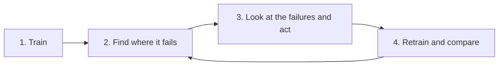

# 5. Explaining the model with Grad-CAM

A clinician will not trust *"melanoma, 87 %"* without knowing **where** the model looked.

Grad-CAM produces a heat map of the image regions that drove a prediction. It is the most common interpretability tool for CNNs.

Everything you need is already installed: `grad-cam` ([pytorch-grad-cam](https://github.com/jacobgil/pytorch-grad-cam)) is pinned in `requirements.txt`, together with its OpenCV dependency.

---

## How Grad-CAM works

For a class $c$ and a convolutional layer with feature maps, coming from $k$ = channel, $A^k$:

1. Back-propagate the class score $y^c$ to the layer: $\dfrac{\partial y^c}{\partial A^k}$.
2. Average the gradients over the $Z$ spatial positions $(i, j)$ to get one weight per channel:

   $$
   \alpha_k^c = \frac{1}{Z} \sum_{i} \sum_{j} \frac{\partial y^c}{\partial A^k_{ij}}
   $$

3. Take the weighted sum of the feature maps and keep the positive part:

   $$
   L^c = \mathrm{ReLU}\left( \sum_k \alpha_k^c \, A^k \right)
   $$

4. Upsample $L^c$ to the image size and overlay it (Hotness = importance).

Selvaraju et al., *Grad-CAM: Visual Explanations from Deep Networks via Gradient-based Localization*, ICCV 2017.

---

## Quick start

Train a model first; every run saves `outputs/<run>/final_model.pt`. Then:

```bash
source .venv/bin/activate
bash scripts/run_simulation.sh data/partitions/iid "num-server-rounds=10 local-epochs=2"

python explainability/gradcam.py --run outputs/<run>          # 12 random test images
```

The script reads the model and the partition folder it was trained on from the run folder.

It writes a PNG next to the model: the input on top, the heat map below, and the true and predicted class in the title (<span style="color:green">Green</span> = correct, <span style="color:red">Red</span> = wrong).


When the model is right, the heat map usually sits on the lesion.

On the first image it is **wrong**, and the heatmap sits on the background in the corners. That is a hint the model used the wrong evidence.

### Options

| Option | Default | Meaning |
|---|---|---|
| `--run outputs/<run>` | | run folder (`final_model.pt` + `metrics.json`) |
| `--model x.pt --partitions dir` | | any other model, e.g. your centralised baseline |
| `--data` | `test` | `test` = global test set, `client_<i>` = that client's validation data |
| `--select` | `all` | `all`, `mistakes` or `correct` |
| `--num-images` | `12` | |
| `--method` | `gradcam` | `gradcam`, `gradcam++`, `hirescam`, `scorecam`, `eigencam` |
| `--layer` | `net.layer_1` | which layer to explain ([see below](#choosing-the-layer)) |
| `--target` | `predicted` | explain the `predicted` class, or the `true` class ("why *not* melanoma?") |
| `--untrained` | off | sanity check: same images, randomly initialised model |
| `--seed` | `0` | which images are picked |

```bash
python explainability/gradcam.py --run outputs/<run> --select mistakes            # only the errors
python explainability/gradcam.py --run outputs/<run> --data client_2 --method gradcam++
python explainability/gradcam.py --run outputs/<run> --select mistakes --target true
python explainability/gradcam.py --model baseline.pt --partitions data/partitions/iid
```

---

## Choosing the layer

Our MONAI `Classifier` downsamples a 28×28 image three times (`print(model)` shows the
structure):

| Layer | Feature map | Heat map |
|---|---|---|
| `net.layer_0` | 14×14 | detailed, but mostly edges and colours (low-level) |
| `net.layer_1` (default) | 7×7 | good compromise for 28×28 images |
| `net.layer_2` | 4×4 | the most "semantic" layer, but very blurry |

The original paper uses the **last** convolutional layer. With tiny MedMNIST images, that map is
only 4×4 pixels:


These are the model's **mistakes** on `net.layer_2`. The coarse maps often sit on the border or the background instead of the lesion.

**Want sharper maps? Use bigger images.** MedMNIST+ comes in 64, 128 and 224 px, and the splitting tool downloads them with `--size`.

The model adapts to the image size automatically:

```bash
python data_splitting/split_data.py --dataset dermamnist --size 64 --num-clients 3 --strategy iid --out data/partitions/iid64
bash scripts/run_simulation.sh data/partitions/iid64 "num-server-rounds=3 local-epochs=2"
python explainability/gradcam.py --run outputs/<run> --num-images 6
```


At 64 px `net.layer_1` is 16×16, so lesion shapes and even hair become visible in the
explanation. Notice the bright regions at the **image borders** and corners on several images:
exactly the kind of shortcut you should investigate. (64 px is about 4× slower to train than 28
px; 224 px needs a GPU and a deeper network such as `monai.networks.nets.DenseNet121` in `build_model()`.)

---

## Sanity check: is the explanation about the *model* at all?

Adebayo et al. (*Sanity Checks for Saliency Maps*, NeurIPS 2018) showed that some saliency
methods give almost the same picture for a **random, untrained** network.

Such maps explain the image (edges, contrast), not the model. Always compare against a randomised model:

```bash
python explainability/gradcam.py --run outputs/<run> --untrained
```


Same 12 images as the first figure. Some maps of the untrained network *also* cover the lesion, because random filters still react to a dark blob on light skin.

Only differences that appear **consistently** between the trained and untrained maps can be credited to what the model learned.
**Report this check!** In a paper, reviewers look for this comparison!

---

## What to look for and put in your report:

* **Right for the right reasons?** On correct predictions, is the   lesion highlighted, or the image border, a ruler, hair, a vignette or the skin colour? Background "shortcuts" are a classic failure in a lot of medical models.
* **Mistakes:** run `--select mistakes`. Do the errors share a pattern (low contrast, very small lesions, a specific class)? This feeds directly into data augmentation or cleaning, see [the iterative process](#the-iterative-process-from-explanation-to-a-better-model) below.
* **Fairness:** compare explanations across subgroups, e.g. skin tones or the image sources/clients. A model that looks at different evidence for different groups is a red flag.
* **Quantify, don't only show pictures:** with segmentation masks, measure how much of the heatmap falls inside the lesion (IoU), averaged over the test set. **Cherry-picked examples are not evidence.**

### Federated-learning specific ideas

| Question | How |
|---|---|
| Does federated training change *what* the model looks at? | Same images, `--run` of a federated model vs. your centralised baseline (`--model baseline.pt`) |
| Does a client with "a different scanner" get worse explanations? | Split with `--feature-skew`, then `--data client_0` vs. `--data client_4` |
| What does a poisoned or noisy client do to the explanations? | Runs with `malicious-clients='4'` or `--label-noise` (see [tutorial 4](04_aggregation_strategies.md)) vs. a clean run |
| Does DP noise destroy interpretability? | Runs with different `dp-noise-multiplier` values |
| How do explanations evolve during training? | Save the global model every round (extend `global_evaluate` in `server_app.py`) and compare round 1 vs. round N |

---

## The iterative process: from explanation to a better model

Explanations are only useful if they change what you do next. Improving a model is a loop:



| Step | Question | Tool |
|---|---|---|
| 1. Train | | `scripts/run_simulation.sh` |
| 2. Find where it fails | Which classes / clients are bad? Which examples always have a high loss? | `explainability/error_analysis.py` |
| 3. Look and act | **(a)** A class is never learned → get more data for it, or make its mistakes cost more (class-weighted loss).<br>**(b)** Some examples always have a high loss → look at them: wrong label, artefact, or genuinely hard? Find an augmentation that separates them from the class they are confused with.<br>**(c)** The task needs finer detail than the network sees → bigger images or a deeper network.<br>**(d)** Nothing above helps for some examples → remove them from training and report it. | `gradcam.py --select mistakes --true-class ...`, `loss-weighting='balanced'`, `--size 64`, `build_model()` |
| 4. Retrain and compare | Did the change help **the problem you targeted**, not only the average? | the same tools on the new run |

If a state-of-the-art model exists for your data, run it on your test set too: the examples
*it* gets wrong are a good list of genuinely hard cases.

Below is one complete pass on the default quick-start split (DermaMNIST 28 px, 3 clients, Dirichlet $\alpha = 0.3$, 10 rounds). All numbers are averages over 3 runs.

### Iteration 0: train and find where it fails

```bash
bash scripts/run_simulation.sh data/partitions/dirichlet "num-server-rounds=10"
python explainability/error_analysis.py --run outputs/<run>
```

```text
test: 2005 samples, accuracy 0.715, balanced accuracy 0.301

class                         support  recall  precision     f1  most confused with
actinic keratoses and intrae       66    0.30       0.35   0.33  melanocytic nevi (21)
basal cell carcinoma              103    0.45       0.43   0.44  melanocytic nevi (40)
benign keratosis-like lesion      220    0.31       0.53   0.39  melanocytic nevi (131)
dermatofibroma                     23    0.00       0.00   0.00  melanocytic nevi (8)  <-- never predicted correctly
melanoma                          223    0.01       0.75   0.03  melanocytic nevi (191)
melanocytic nevi                 1341    0.97       0.76   0.85  benign keratosis-like lesion (27)
vascular lesions                   29    0.07       1.00   0.13  melanocytic nevi (19)
```


An accuracy of 0.715 looks fine, but **the model has learnt "everything is a mole".**
Melanocytic nevi are 67 % of the test set, and almost every other class is predicted as nevi.

**Melanoma, the class that matters most clinically, has a recall of 0.01.** This is failure (a).

`error_analysis.py` also saves the hardest examples (highest loss):


They are almost all melanomas, dermatofibromas and vascular lesions predicted as nevi, most of them with more than 90 % confidence. Nothing suggests broken images or obvious labelling errors (for that, we usually ask a domain expert), so (d) does not apply yet. Grad-CAM on exactly these mistakes:

```bash
python explainability/gradcam.py --run outputs/<run> --select mistakes --true-class melanoma
```


The evidence for "nevi" is the **surrounding skin, not the lesion**. "Nevi" is the model's default answer, and nothing in the lesion is pulling it towards melanoma.

### Iteration 1: make the rare classes count (action a)

We cannot collect more images, but we can make every mistake on a rare class cost more. With `loss-weighting='balanced'`, every client weights its loss by the inverse frequency of each class in **its own** data (`balanced_class_weights()` in `task.py`):

```bash
bash scripts/run_simulation.sh data/partitions/dirichlet "num-server-rounds=10 loss-weighting='balanced'"
```

Balanced accuracy rises from 0.295 to 0.408, and dermatofibroma, vascular lesions and the carcinomas are found much more often. Accuracy drops (0.714 → 0.627) because fewer nevi are "free" correct answers: the classic trade-off, which should be reported.

**But melanoma stays at 0.07.** Why?

### Diagnosis: is it the data or the federation?

```bash
python explainability/error_analysis.py --run outputs/<run> --data client_2
```

The split shows the cause (see `label_distribution.png`): **client 2 holds 708 of the 752 melanoma training images**. Yet the global model reaches only 0.43 accuracy on client 2's own validation data. A centralised model trained on the same images  finds 50% of the melanomas. So the images are learnable, and **the federation loses what client 2 knows**. FedAvg weights clients by their size, so client 1 (4407 images, 77 % nevi) dominates every average.

### Iteration 2: Give the right but underrepresented client a voice

That is a fairness problem, so we use the fairness strategy:
[q-FedAvg](04_aggregation_strategies.md#4-fairness-q-fedavg-qfedavg) gives clients with a higher loss a larger weight.

```bash
bash scripts/run_simulation.sh data/partitions/dirichlet \
    "num-server-rounds=10 loss-weighting='balanced' strategy='qfedavg' qfedavg-q=1.0"
```

### Results of the iterations

| Iteration | Change | Accuracy | Balanced acc. | Melanoma recall | Accuracy on client 2 |
|---|---|---|---|---|---|
| 0 | FedAvg | **0.714** | 0.295 | 0.01 | 0.46 |
| 1 | + `loss-weighting='balanced'` | 0.627 | 0.408 | 0.07 | 0.43 |
| 2 | + `strategy='qfedavg' qfedavg-q=1.0` | 0.656 | **0.428** | **0.17** | **0.50** |
| ref. | centralised, plain loss (10 epochs, 1 run) | 0.737 | 0.473 | 0.27 | |
| ref. | centralised, balanced loss (10 epochs, 1 run) | 0.574 | 0.537 | 0.50 | |


Changes that did **not** help with melanoma (1 run each, balanced loss): 64 px images
(melanoma recall 0.00), 20 rounds (0.02), 3 or 5 local epochs (0.02 / 0.01), FedProx (0.02), FedAdam (0.10), FedAvgM with 3 local epochs (0.08). Report these too. A negative result with a reasonable explanation ("Bigger images do not help while the client that holds the melanomas is outvoted.") is also a contribution towards a  finding.

## Back to step 2 with the new model: what does it look at when it finds a melanoma?

```bash
python explainability/gradcam.py --run outputs/<run> --select correct --true-class melanoma
```


Many maps now land on the lesion and its irregular border. **Several sit on the image edge or the dark vignette corners**, so the model may be using the photo setup as a shortcut. That is the question for iteration 3: for example, crop or mask the vignette, check the untrained sanity check on the same images, or try a strategy that corrects client drift (e.g. [SCAFFOLD](https://github.com/Mirko6/federated_learning_scaffold)), since federated melanoma recall (0.17) is still far below centralised (0.50).

Keep a table like the [results of the iterations above](#results-of-the-iterations) in your report, **one row per iteration**: change, why you made it (which failure from step 2), and what it did to the metric you targeted.

---

## Using Grad-CAM in your own code / notebook

```python
import numpy as np
import torch
from pathlib import Path
from pytorch_grad_cam import GradCAM
from pytorch_grad_cam.utils.image import show_cam_on_image
from pytorch_grad_cam.utils.model_targets import ClassifierOutputTarget
from aitdm_fl.task import load_npz_arrays, model_from_test_set

model = model_from_test_set("data/partitions/iid")
model.load_state_dict(torch.load("outputs/<run>/final_model.pt"))
model.eval()

x, y = load_npz_arrays(Path("data/partitions/iid/test.npz"), "test")   # (N, C, H, W) in [0, 1]
images = torch.from_numpy(x[:8])

with GradCAM(model=model, target_layers=[model.net.layer_1]) as cam:
    heatmaps = cam(input_tensor=images, targets=[ClassifierOutputTarget(int(c)) for c in y[:8]])

overlay = show_cam_on_image(x[0].transpose(1, 2, 0), heatmaps[0], use_rgb=True)  # (H, W, 3) uint8
```

MONAI ships its own implementation too, which is handy for 3D volumes (`spatial_dims=3`):

```python
from monai.visualize import GradCAM
cam = GradCAM(nn_module=model, target_layers="net.layer_1")
maps = cam(x=images)   # (N, 1, H, W), already upsampled and normalised to [0, 1]
```

### Not working with images?

Grad-CAM needs convolutional feature maps. For **HAR** (skeleton or sensor sequences, tabular features), `explainability/feature_importance.py` measures which joints / statistics the model relies on (permutation importance, see [tutorial 6](06_har.md#5-explain-it)).

For per-sample explanations use attribution methods such as **SHAP** (`pip install shap`) or **Integrated Gradients** (`pip install captum`). They tell you which joints, sensors or time steps drove a prediction. 

Add the package to `requirements.txt` with a fixed version so your teammates get the same one.

## References

* [Selvaraju et al., *Grad-CAM*, ICCV 2017](https://arxiv.org/abs/1610.02391)
* [Chattopadhyay et al., *Grad-CAM++*, WACV 2018](https://arxiv.org/abs/1710.11063)
* [Adebayo et al., *Sanity Checks for Saliency Maps*, NeurIPS 2018](https://arxiv.org/abs/1810.03292)
* [Gildenblat et al., *pytorch-grad-cam*](https://github.com/jacobgil/pytorch-grad-cam)
