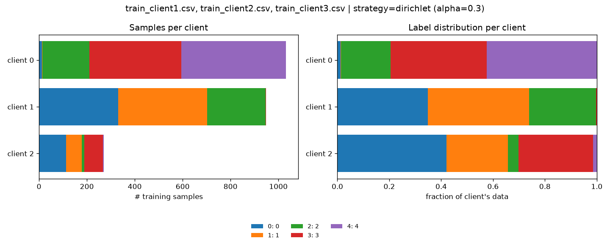
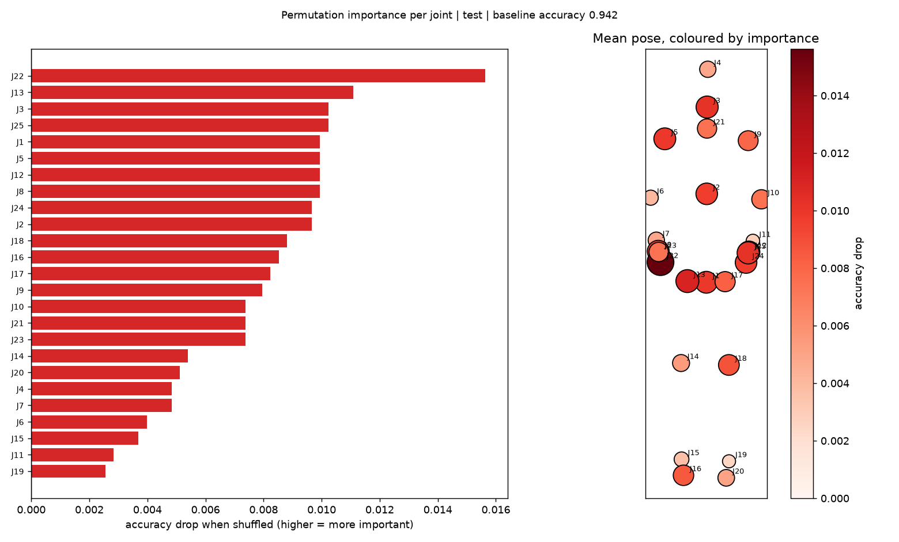
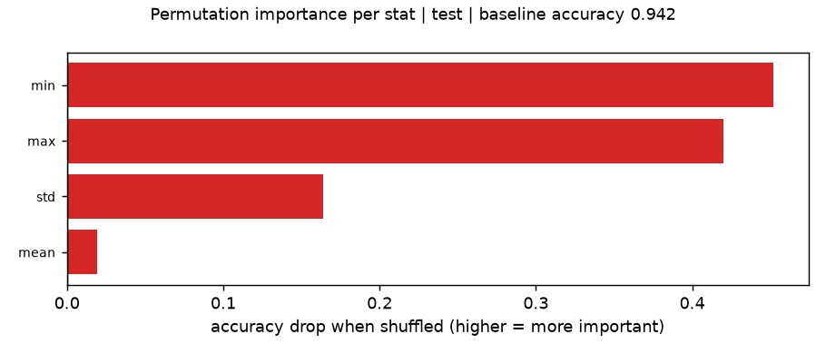

# 6. Human Activity Recognition (HAR)

The medical examples use images.

This tutorial runs the **same pipeline on skeleton data**:

split → federated training → trust experiments → explanations.

Only the first step and the explanation tool differ, so read tutorials [2](02_running_flower.md) and [3](03_biased_data_splits.md) first.

---

## 1. Get the data

The HAR data is shared on **Moodle** (it is not part of this repository). Put the CSV files in
`data/raw/har/`:

```text
data/raw/har/
├── train_client1.csv
├── train_client2.csv
└── train_client3.csv
```

<!-- `data/` is git-ignored: **never commit the data** to your GitHub repository. -->

Each row is **one frame** of a skeleton sequence:

| Column | Meaning |
|---|---|
| `IDSample` | id of the sequence: all rows with the same id form **one** sample |
| `FrameNumber` | position of the frame in the sequence |
| `J1X, J1Y, J1Z ... J25X, J25Y, J25Z` | 3D position of the 25 skeleton joints (metres) |
| `Action` | the class: 5 actions, labelled `0` ... `4` |
| `Camera` | which camera (`1`, `2`, `3`) recorded the sequence |

Together the three files contain 3 354 sequences of 30–516 frames (about 75 on average). The classes are balanced, and each file has a random third of the data (same mix of actions and cameras).

---

## 2. Split it

`split_data.py` reads several CSV files at once (they are concatenated, and each row remembers its file in a new column `source_file`):

```bash
source .venv/bin/activate

# Natural split: one client per camera (3 clients)
python data_splitting/split_data.py --input data/raw/har/train_client*.csv \
    --label-col Action --sample-col IDSample --feature-cols '^J' \
    --strategy group --group-col Camera --num-clients 3 --out data/partitions/har_camera
```

* `--label-col Action`: the class.
* `--sample-col IDSample`: the frames of one sequence stay together (in the same client, and in the same train / val / test part).
* `--feature-cols '^J'`: a regular expression: the joint columns are the features. Without it, every numeric column would be used, including `FrameNumber` and `Camera`.

Other useful splits:

```bash
# The split as shipped: train_client1/2/3.csv are one client each (nearly IID, a good baseline)
... --strategy group --group-col source_file --num-clients 3 --out data/partitions/har_files

# Label skew: 5 clients that each see mostly some actions
... --strategy dirichlet --alpha 0.3 --num-clients 5 --out data/partitions/har_dirichlet

# Every camera differently calibrated (gain / offset / noise per coordinate)
... --strategy group --group-col Camera --num-clients 3 --feature-skew --out data/partitions/har_camera_skew

# Give the actions readable names in plots and reports (in the order 0, 1, 2, ...)
... --class-names "action A,action B,action C,action D,action E"
```

(`...` = `python data_splitting/split_data.py --input data/raw/har/train_client*.csv --label-col Action --sample-col IDSample --feature-cols '^J'`)



`--label-noise` and all other options from [tutorial 3](03_biased_data_splits.md) work too.

### From sequences to feature vectors

Sequences have different lengths, but the model needs inputs of a fixed size. For every sequence, `split_data.py` computes four statistics of every joint coordinate over time:

```text
mean, std, min, max   x   75 columns (J1X ... J25Z)   =   300 features per sample
```

These simple statistics already separate the 5 actions well (see the results in
[step 3](#3-train-it)), so they make a good starting point. [Section 6](#6-going-further) indicates towards richer directions in which you could take your project.

---

## 3. Train it

Nothing changes: the Flower app sees 2D arrays instead of images and builds an **MLP** (300 inputs → 256 → 128 → 5 actions, with dropout) instead of the CNN used for moles classification. See `build_model()` in `fl_app/aitdm_fl/task.py`.

```bash
# Simulation
bash scripts/run_simulation.sh data/partitions/har_camera "num-server-rounds=10 local-epochs=3"

# Deployment (SuperLink + SuperNodes as separate processes)
bash scripts/run_deployment_local.sh data/partitions/har_camera "num-server-rounds=10 local-epochs=3"
```

In separate terminals it is also the same as before:
`bash scripts/start_supernode.sh 0 data/partitions/har_camera` and so on.

Results on CPU (10 rounds, 3 local epochs, seed 42, global test set of 704 sequences):

| Setup | Test accuracy |
|---|---|
| Centralised baseline (all training data, 30 epochs) | 0.953 |
| FL, one client per camera | 0.942 |
| FL, one client per file + `--feature-skew` | 0.933 |
| FL, Dirichlet α = 0.3, 3 clients | 0.807 |

Label skew costs the most, as for the medical images. This dataset is small, so a run takes less than a minute: try several seeds and report mean ± std.

### Centralised baseline

Stage 1 asks for a centralised vs. federated comparison. Train the same model on the union of the clients' training data and test on the same `test.npz`:

```python
from pathlib import Path

import numpy as np
from torch.utils.data import DataLoader

from aitdm_fl.task import (ArrayDataset, evaluate, get_device, load_npz_arrays,
                           load_test_data, model_from_test_set, train)

partitions = Path("data/partitions/har_camera")
parts = [load_npz_arrays(path, "train") for path in sorted(partitions.glob("client_*.npz"))]
x = np.concatenate([p[0] for p in parts])
y = np.concatenate([p[1] for p in parts])
loader = DataLoader(ArrayDataset(x, y), batch_size=32, shuffle=True)

model = model_from_test_set(str(partitions))
train(model, loader, epochs=30, lr=1e-3, device=get_device())
print(evaluate(model, load_test_data(str(partitions)), get_device()))
```


---

## 4. Trust experiments

All options from [tutorial 4](04_aggregation_strategies.md) work unchanged. Same setup as [above](#3-train-it) (camera split, 10 rounds, 3 local epochs):

| Experiment | Test accuracy |
|---|---|
| No attacker, FedAvg | 0.942 |
| Client 2 sends sign-flipped weights, FedAvg | 0.210 (chance level) |
| ... FedMedian | 0.911 |
| ... Krum | 0.930 |
| FedProx | 0.929 |
| Differential privacy, $\sigma = 0.5 (\epsilon \approx 49,  \delta = 10^{-5})$ | 0.321 |

```bash
bash scripts/run_simulation.sh data/partitions/har_camera \
    "num-server-rounds=10 local-epochs=3 strategy='krum' malicious-clients='2'"
```

> With 3 clients, Krum's guarantee (K > 2f + 2) does **not** hold, even if it happens to work here. For a robustness experiment you can defend in the report, use 5+ clients (e.g. the Dirichlet split with `--num-clients 5`).

---

## 5. Explain it

Grad-CAM needs images, so for feature data use **permutation importance**: shuffle one feature (or a group of features) between the samples, which breaks its link with the label, and measure how much the accuracy drops. The bigger the drop, the more the model relies on it.

```bash
# Which joints matter? (all statistics of a joint are shuffled together)
python explainability/feature_importance.py --run outputs/<run>

# Which statistics matter? (mean / std / min / max)
python explainability/feature_importance.py --run outputs/<run> --group-by stat

# On one client's validation data
python explainability/feature_importance.py --run outputs/<run> --data client_0

# Sanity check: an untrained model
python explainability/feature_importance.py --run outputs/<run> --untrained
```

| Option | Meaning |
|---|---|
| `--group-by joint` (default) | J5 = mean/std/min/max of J5X, J5Y, J5Z (12 features) |
| `--group-by column` | J5X = its 4 statistics |
| `--group-by stat` | `mean`, `std`, `min`, `max` (75 features each) |
| `--group-by feature` | each of the 300 features alone |
| `--repeats 5` | shuffles per group, averaged |

The script saves a PNG and a JSON (all values) in the run folder. With `--group-by joint`, the plot also shows the **mean pose** of the data, with each joint coloured by its importance:



What the camera-split model (test accuracy 0.942) shows:

| Shuffled group | Accuracy drop (trained) | Accuracy drop (untrained) |
|---|---|---|
| `min` of all joints | 0.452 | −0.062 |
| `max` of all joints | 0.420 | 0.012 |
| `std` of all joints | 0.164 | 0.018 |
| `mean` of all joints | 0.019 | 0.034 |
| the most important single joint (J22) | 0.016 | ~0.006 |



How to read this (and what to write in the report):

* **The range of a movement (min / max) matters, the average position barely.** That makes sense for actions: they differ in how far the body moves, not in where it stands.
* **Every single joint looks unimportant** (≤ 0.016) **although the joints together are crucial.** 
The joints are strongly correlated: if one is shuffled, its neighbours still carry the information. Permutation importance **underestimates correlated features**, so group them (`--group-by stat` or `joint`) before you conclude that something does not matter.
* For trust: does the importance differ between clients (`--data client_<i>`)? Does an attacked or
  DP-trained model rely on different joints?

<!-- The joint numbering follows the data. The mean pose (J4 at the top, J15 / J16 / J19 / J20 at the bottom) matches the usual 25-joint Kinect v2 layout. -->

`explainability/error_analysis.py` (per-class recall, confusion matrix, hardest examples) also works on HAR runs. See [the iterative process](05_gradcam.md#the-iterative-process-from-explanation-to-a-better-model).


---

## 6. Going further

| I want to... | Where |
|---|---|
| change the MLP | `build_mlp()` in `fl_app/aitdm_fl/task.py` |
| use other per-sequence features (velocities, joint angles, ...) | `sample_features()` in `data_splitting/split_data.py` |
| use a sequence model (LSTM / GRU / 1D CNN / transformer) on the raw frames | read `client_<i>_train.csv` / `client_<i>_val.csv` / `test.csv` and adapt `load_npz_arrays()` / `load_client_data()` / `load_test_data()` in `task.py`; the Flower code stays the same |
| simulate other device differences | `apply_sensor_skew()` in `data_splitting/partitioning.py` |
